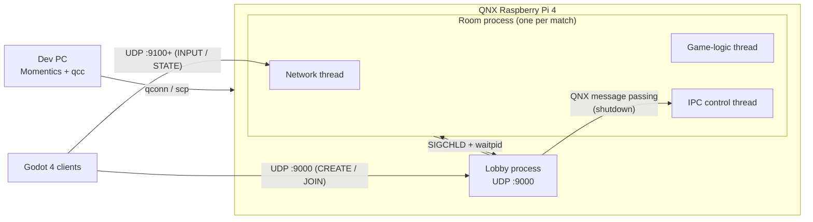
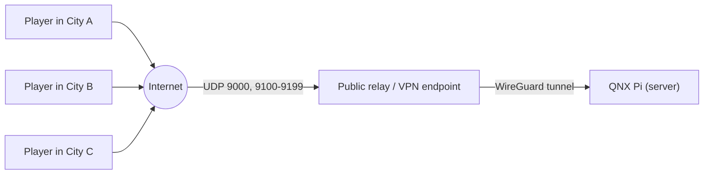

# QNX Neon Arcade — Real-Time Multiplayer Game on QNX

A server-authoritative multiplayer arcade running **natively on QNX Neutrino (Raspberry Pi 4)**, with **Godot 4** clients over UDP.
Three games (Pong, Shooter, Tic-Tac-Toe), one lobby, and **one isolated OS process per match**.

> **Industry use case #11 — Real-Time Multiplayer Game** (QNX Canada industry projects for universities)
> **Problem statement:** multiplayer games require low-latency synchronization between players.
> **Brief:** implement a simple game on QNX (Unity or Godot) with deterministic event handling and real-time networking; self-contained, or with AR/VR elements.

The games are the *workload*. The real question this project answers is: **how do you run several real-time networked sessions on one cheap board so that one session's crash or load cannot take down the others?** That is the same pattern used in automotive, medical and industrial systems, which is why QNX is the platform.


Full demo video: [`multiplayer_game/OUTPUT DEMO.mp4`](multiplayer_game/OUTPUT%20DEMO.mp4)

---

## Screenshots

| Lobby | Pong |
|---|---|
|  |  |

| Shooter (2–4 players) | Tic-Tac-Toe |
|---|---|
|  |  |

Live HUD with round-trip ping and server tick jitter:


---

## Brief vs. what is built

| Requirement from the brief | What this project does | Status |
|---|---|---|
| Simple game on QNX | 3 games, server runs natively on QNX 8.0 (aarch64) | Done |
| Unity or Godot | Godot 4.6 clients | Done |
| Low-latency synchronization | Server-authoritative state, UDP, ~10–23 ms LAN ping | Done |
| Deterministic event handling | Event *ordering* is deterministic (one input queue, one logic thread, fixed-step tick). Timing is **soft real-time** | Partial, see [limitations](#known-limitations) |
| Real-time networking | UDP lobby + one UDP port per room | Done |
| Optional AR/VR | Not yet, see [roadmap](#roadmap-3d-vr-ar) | Planned |

---

## Architecture



**Data path:** client input → network thread → input queue → game-logic thread → authoritative state → `STATE` broadcast → clients.

### Threads and priorities (per room)

| Game | Tick rate | Network thread | Logic thread | Scheduler |
|---|---|---|---|---|
| Pong, Shooter | 60 Hz | priority 20 | priority 18 | `SCHED_RR` |
| Tic-Tac-Toe | 20 Hz | priority 16 | priority 14 | `SCHED_RR` |

The network thread is always 2 levels above the logic thread, so incoming input preempts simulation and a heavy tick can't delay a packet.

### How QNX is actually used

| Feature | QNX-specific? | Used for |
|---|---|---|
| Message passing: `name_attach`, `name_open`, `MsgSend`, `MsgReceive`, `MsgReply` | **Yes** | Lobby → room shutdown. `MsgSend` blocks until the room confirms |
| Process-per-room isolation (microkernel process model) | Architecture | A crashed room cannot corrupt another room |
| `slog2` | **Yes** | Server diagnostics and tick telemetry |
| `SCHED_RR` priorities | POSIX, made meaningful by QNX's preemptive scheduler | Input preempts simulation |
| `fork`, `waitpid`, `SIGCHLD`, `shm_open`, pthreads | POSIX | Room lifecycle, shared room status |
| Momentics, `qcc`, `qconn` | QNX toolchain | Build and deploy |

Honest note: scheduling alone is not unique to QNX. The real QNX advantages here are **process-level fault containment**, **message-passing IPC**, and the **safety-certified path** (see roadmap).

### Protocol (UDP, text lines)

| Message | Direction | Meaning |
|---|---|---|
| `CREATE,<game>` → `ROOM,<id>,<port>` | client ↔ lobby | Create a room |
| `SHUTDOWN,<id>` → `SHUTDOWN_OK,<id>,ipc` | client ↔ lobby | Close a room (room creator or localhost only) |
| `JOIN` → `WELCOME,<seat>` | client ↔ room | Take a seat |
| `INPUT,...` / `PING` → `PONG` | client → room | Player input and RTT probe |
| `STATE,...` / `WIN,...` | room → clients | Authoritative game state |
| `JITTER,<avg_ms>,<max_ms>` | room → clients | Server tick-interval jitter every 3 s |

---

## Performance

Measured on a Raspberry Pi 4 running QNX 8.0 over a LAN:

| Metric | Value | Notes |
|---|---|---|
| Server tick | 60 Hz (16.67 ms) | Pong, Shooter |
| Tick jitter (avg) | ~0.33 ms | About 2% of the tick period |
| Tick jitter (worst case) | *add your measured max here* | Reported by `JITTER,avg,max` |
| Round-trip ping | ~10–23 ms | LAN |
| Rooms tested concurrently | 3 | Higher counts untested |

Jitter = |actual tick interval − target interval| over the last 3-second window. This is **soft real-time**: predictable priority-based behaviour, not a hard-deadline guarantee.

---

## Quick start

### 1. Build the server (QNX SDP 8.0, Windows or Linux host)

```bash
# Momentics: File > Import > Existing Projects > multiplayer_game/server1_3
# Set active configuration: aarch64le-debug, then Project > Clean > Build
# or from a qnxsdp-env shell:
cd multiplayer_game/server1_3
make clean && make
```

Output: `build/aarch64le-debug/server1_3`

### 2. Run on the Pi

```bash
scp build/aarch64le-debug/server1_3 qnxuser@<PI_IP>:~/
ssh qnxuser@<PI_IP>
slay server1_3            # kill leftover rooms
chmod +x server1_3
./server1_3 --mode=lobby  # listening on UDP 9000; run from the same folder every time
```

### 3. Run the client

Open the Godot project in **Godot 4.6.x**, press Run, enter the Pi's IP, click **Connect**, then **Create** a game. On a second machine click **Refresh** and **Join**.

Network requirement: UDP **9000** (lobby) and **9100+** (rooms) must be reachable from the clients.

### Demo script: fault isolation

```bash
pidin                      # list the lobby and room processes
slog2info -w               # live logs
kill -9 <one room pid>     # the other rooms keep running; the lobby reaps the dead one
```

---

## Playing over the internet (real players, different locations)

Today the project is tested on a LAN. The server is plain UDP, so reaching it from other cities is a **deployment** problem, not a rewrite. Four options, easiest first:



| Option | How | Pros | Cons |
|---|---|---|---|
| **LAN** (current) | Same Wi-Fi, IP box in the lobby | Zero setup, tested | One site only |
| **Private VPN overlay** | Everyone joins one WireGuard/Tailscale-style network; players type the server's VPN IP | No port forwarding, works behind most NATs, encrypted | Players must install the VPN. As far as I know there is no official Tailscale client for QNX, so run the VPN on a Linux gateway on the Pi's LAN |
| **Public relay (VPS)** | A small VPS with a public IP forwards UDP 9000 and 9100–9199 to the Pi through a WireGuard tunnel that the **Pi dials out to** | Works behind CGNAT (common on home ISPs), players need nothing installed | Extra hop adds latency, small hosting cost |
| **Router port-forward + DDNS** | Forward UDP 9000 and 9100–9199 to the Pi, use a dynamic DNS name | Direct path, lowest latency | Fails if the ISP uses CGNAT, exposes the Pi directly |

### What must change before exposing it publicly

1. **Authentication:** per-room secret token (the current room-owner check is IP-based and spoofable).
2. **Encryption:** run inside WireGuard now; DTLS or an authenticated packet format later.
3. **Rate limiting and input validation** per source address.
4. **Port range:** each room uses its own UDP port, so the forwarded range (9100–9199) caps concurrent rooms.
5. **WAN netcode:** add sequence numbers and timestamps, client-side prediction, entity interpolation, and server-side lag compensation. RTT grows with distance, so cross-continent play typically needs these to feel smooth.
6. **Regional servers:** one Pi (or relay) per region, with the lobby recommending the lowest-ping one.

---

## Roadmap: 3D, VR, AR

The architecture already separates **authoritative simulation (QNX server)** from **rendering (Godot client)**. That is exactly the split 3D, VR and AR need: the server never draws anything, so new front-ends only change the client and the state messages.

### Phase 1: 3D games
- **How:** build the client with Godot 4 3D scenes (`Node3D`, `CharacterBody3D`). Add a new game module on the server (same module interface as Pong and Shooter) with 3D position, rotation and velocity in `STATE`.
- **Server work:** 3D physics step, interest management (only send nearby entities), compact binary packets once text becomes the bottleneck.
- **Why it matters:** proves the same room-process design scales to heavier state.

### Phase 2: VR
- **How:** Godot 4's OpenXR support (for example Meta Quest via the OpenXR vendor plugin). Reuse the 3D game module and add head and hand pose to the client's `INPUT`.
- **Latency design:** head tracking and rendering stay **local** on the headset, so the motion-to-photon budget (QNX brief #14 targets at or below 10 ms) is a local render-pipeline problem. The network only carries *other players'* poses, which are interpolated, so ping does not directly cause motion sickness.
- **Server work:** higher tick and broadcast rates for pose data, per-room priority bands tuned for the VR rooms.

### Phase 3: AR
- **How:** OpenXR passthrough on a headset, or mobile AR (ARCore / ARKit plugins) in Godot.
- **Shared space:** players align to a common anchor (marker or spatial anchor) and the server stores positions relative to that origin, so everyone sees the same virtual objects in the same real place.

### QNX-side roadmap

| Item | Why |
|---|---|
| **Adaptive partitioning** | Guaranteed CPU budget per room, so one overloaded room can't starve the others |
| **QNX System Profiler / tracing** | Find the cause of worst-case jitter spikes instead of just measuring them |
| **Resource manager per room** | Expose rooms as paths (for example `/dev/arcade/room1`), the native QNX way |
| **Linux comparison on the same Pi** | Same code, same load, measured jitter on both. The code already builds on Linux |
| **Reconnect and session resume** | A dropped client rejoins its room |
| **Larger load test (10+ rooms)** | Find the real scaling limit |
| **QNX Hypervisor split (brief #17)** | Safety-critical and non-critical workloads on one SoC, the real automotive use of this isolation idea |

---

## Engineering notes (hardening already applied)

- Queue mutex uses `PTHREAD_PRIO_INHERIT` (avoids priority inversion between the network and logic threads).
- Condition-variable waits use `CLOCK_MONOTONIC`.
- Fixed-step tick schedule (`next_tick += period`), so a late tick never shifts later ticks.
- Sockets are close-on-exec, so rooms don't inherit the lobby's port-9000 socket.
- `SHUTDOWN` is accepted only from the room creator's IP or localhost.
- Jitter is reported as both average and worst case.

## Known limitations

- **Soft real-time, not hard real-time.** Jitter is measured, not guaranteed.
- Not bit-for-bit deterministic: physics uses elapsed time and Pong serves randomly. A fixed simulation step with a seeded RNG would make replays identical.
- Room-owner check is IP-based (spoofable). A per-room token is the proper fix.
- No reconnect, no auto-respawn of crashed rooms, and only 3 concurrent rooms tested.
- Runs on a standard Raspberry Pi 4, which is **not a safety-certified target**. This is an architecture demonstration, not a safety claim.
- `fallback/arcade_linux_x86_64` runs the same server on Linux for emergencies only (no QNX features).

---

## Repository layout

```
multiplayer_game/
  server1_3/            QNX server (lobby + room processes + games), Makefile, README.txt
  arcade_final.zip, arcade_client_FINAL (1).zip   Godot 4 client project (zipped)
  OUTPUT DEMO.mp4       Demo video
  *.pptx, *.docx        Presentation and project report
docs/images/            Screenshots and demo preview used by this README
```

## Tech stack

QNX SDP 8.0 (Neutrino, aarch64le) · C (POSIX + QNX APIs) · Raspberry Pi 4 · Godot 4.6 (GDScript) · UDP

## Credits

Built for the QNX Canada university industry-projects program, use case #11.
